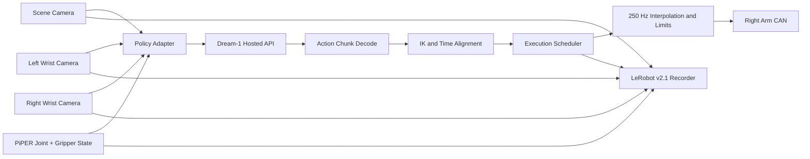
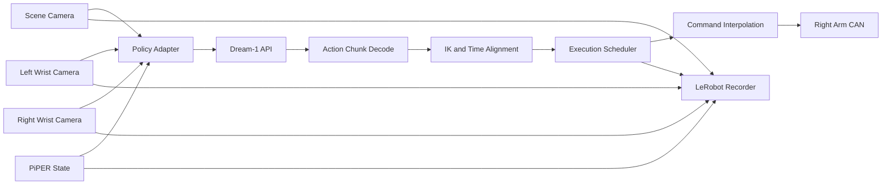

# Piper × Dream Runtime

**中文** | [English](#english)

面向 AgileX PiPER 双臂机器人的 Dream-1 云端策略运行时。项目提供硬件驱动、统一的 Policy Adapter、异步动作块执行、平滑插值、回零工具，以及 LeRobot v2.1 格式的数据采集。


> 这是研究与部署运行时，不是经过安全认证的工业控制系统。实机运行前必须完成急停、TCP、夹爪、相机和关节零位核验。

## 项目定位

PiPER 与 Dream-1 使用不同的模型接口和机器人接口。本项目把两者之间的适配拆成可验证的层：

- **Policy Adapter**：固定相机角色、机械臂状态和动作语义。
- **Inference Runtime**：调用 Dream-1 托管策略，异步获取 48 步动作块。
- **Execution Layer**：执行 IK、时间对齐、250 Hz 插值、速度限制和关节限位检查。
- **Data Layer**：把观测、执行动作、原始模型回复和相机视频保存为 LeRobot v2.1 episode。
- **Safety Utilities**：只读反馈、软回零、发送通道隔离和 CAN 故障检查。

设计参考了 [ManiMux](https://github.com/SII-LiuLab/manimux) 对 Policy Adapter、数据、调度和执行的分层，但本项目不是 ManiMux 的 fork，也不包含其未公开的站点调优配置或模型权重。

## 当前能力

- Dream-1 hosted inference：`dreamlabs/dream-1-beta`
- 双 PiPER 观测，支持单右臂执行、左臂只读
- 工具位姿动作经 Dream IK 转换为关节目标
- 异步 action-chunk refill，避免每块动作执行完才请求下一块
- 250 Hz 命令插值和 stale action 跳过
- 关节限位、反馈新鲜度、控制器状态和 CAN 发送方向检查
- 手动触发的缓慢软回零
- 三路 RealSense：场景、左腕、右腕
- 实际执行时自动录制 LeRobot v2.1 格式 episode
- 数据索引会拒绝 partial/empty episode，并要求任务成功标签后才允许用于训练

## 系统架构



## 硬件与环境

### 硬件假设

- AgileX PiPER 双臂
- 两台从臂分别连接 `can1`（左）和 `can0`（右）
- RealSense 场景相机与左右腕相机
- 支持 E-stop 的实机环境
- Ubuntu 主机和可用的 Dream Labs API 凭证

相机序列号、CAN 通道和机械参数与具体设备有关。提交代码或公开仓库前，请检查配置文件，不要发布 API Key、密码、内部路径、人员信息或未经处理的实际设备序列号。

### Python 环境

项目按 Python 3.12 开发和运行：

```bash
source ~/dream-env/bin/activate
python --version
pip install --upgrade dreamlabs
```

Dream API 凭证请按 Dream Labs 官方流程配置。不要把凭证写入 YAML、Python 文件或 Git。

## 快速开始

```bash
cd ~/dream_piper
source ~/dream-env/bin/activate
cp examples/piper_right.example.yaml my_robot_right.yaml
cp examples/piper_readonly.example.yaml my_robot_readonly.yaml
```

将示例 YAML 中的 `REPLACE_ME_*` 相机序列号替换为当前设备的值。`my_robot*.yaml` 已被 `.gitignore` 排除。

### 1. 只读检查关节与夹爪

```bash
python -B read_joints.py --arm right
```

该命令只读取反馈，不使能电机，也不发送目标。

### 2. 预览运行

预览模式会启动相机、读取双臂状态并查询 Dream，但右臂目标只会写入预览日志：

```bash
python -B run_piper_right.py \
  --task "Use only the right arm to place the rolling pin into the red bowl. Keep the left arm still." \
  --max-seconds 60
```

### 3. 实机执行

> 仅在现场确认工作区无人、无障碍物，并能够立即触发硬件急停时运行。

```bash
python -B run_piper_right.py \
  --task "Use only the right arm to place the rolling pin into the red bowl. Keep the left arm still." \
  --max-seconds 300 \
  --execute
```

`--execute` 是移动机械臂的显式开关。当前右臂-only 入口只允许 `can0` 发送，左臂目标由 capture driver 丢弃。

### 4. 缓慢回零

回零前应确认夹爪为空、双臂完整扫掠路径无碰撞，并由操作者在现场观察：

```bash
python -B return_zero.py
python -B return_zero.py --execute --confirm-clear-path
```

第一条命令只预览计划；第二条命令才会发送动作。回零失败时程序不会自动重试，也不会自动掉电。

## 数据与 Policy Adapter

右臂-only 实际运行默认记录到：

```text
logs/rollouts_right/<timestamp>_run1/
```

每个 episode 包含：

- `meta/info.json`：LeRobot v2.1 feature schema
- `data/chunk-000/episode_000000.parquet`：观测状态和执行动作
- `videos/chunk-000/`：三路相机视频
- `chunks/reply_*.npz`：Dream 原始回复
- `rollout.json`：任务、checkpoint、帧数、结束原因和运行参数

Policy Adapter 的稳定字段定义在 `piper_policy_adapter.py`：

| 模型角色 | 本地相机 |
|---|---|
| `overhead` | `scene` |
| `wrist_l` | `wrist_l` |
| `wrist_r` | `wrist_r` |

状态与动作字段顺序：

```text
left_joint_0 ... left_joint_5, left_gripper,
right_joint_0 ... right_joint_5, right_gripper
```

动作增加“是否实际执行”的权限标记。例如右臂-only 运行时：

```json
{
  "left": false,
  "right": true
}
```

这意味着左臂数值可以用于观测或分析，但不能当作已执行的训练动作。

### 审计已有 episode

```bash
python -B piper_policy_adapter.py \
  --root logs/rollouts \
  --output logs/rollout_index.json
```

审计状态包括：

- `training_ready`：完整数据且 `task_success: success`
- `candidate_needs_task_success_label`：录制完整，但尚不能证明任务成功
- `rejected`：partial、empty、字段不匹配或缺少数据/视频

“录制完成”不等于“成功演示”。成功标签必须来自人工判定、自动评测或正式任务指标。

## 关键配置

主配置位于 `my_robot_right.yaml`。常用字段：

| 配置 | 含义 |
|---|---|
| `control_hz` | Dream action row 的执行频率，当前为 20 Hz |
| `command_hz` | CAN 命令线程频率，当前为 250 Hz |
| `command_interp_max_s` | 单条 action row 的最长插值时间 |
| `action_horizon` | Dream 返回的 action chunk 长度 |
| `obs_window` | 发给策略的观测窗口 |
| `max_ee_speed_m_s` | 末端速度上限 |
| `sync_above_ms` | 根据 RTT 切换同步/异步行为的阈值 |
| `action_timeout_s` | 动作请求迟到判定时间 |
| `max_stall_ticks` | 无动作缓冲时的停机阈值 |

提高速度前应先验证：

1. TCP 与真实夹持点一致；
2. 相机安装和相机角色一致；
3. 关节零位、方向和限位正确；
4. 工作区内不存在碰撞路径；
5. 速度提高后仍能及时执行回零和急停。

## 目录结构

```text
piper_driver.py            被动 CAN 反馈与健康状态
piper_control.py           实机控制驱动
piper_readonly.py          只读驱动
piper_right_only.py        右臂执行、左臂只读的通道隔离
run_piper.py               Dry-run、超时和 teardown 生命周期
run_piper_right.py         右臂-only 主入口
piper_policy_adapter.py    数据/模型字段与 episode 审计
return_zero.py             双臂软回零
my_robot_right.yaml        PiPER、相机和运行时配置
test_*.py                  离线单元测试
```

## 已验证与未验证

已经验证的内容包括：

- Dream-1 推理与异步 action-chunk 运行
- 250 Hz 动作插值和执行链
- 右臂 CAN 发送、左臂零发送隔离
- 超时中止后的受控清理
- 右臂软回零
- LeRobot episode 录制与离线 schema 审计

仍未被充分验证的内容包括：

- 真实夹爪 TCP 的计量学标定
- 相机到机器人坐标系的完整手眼外参
- 对不同任务的通用成功率
- 全速运动下的定位精度
- Dream-1 在 PiPER 上的站点级微调权重
- 自动判断任务是否成功

预览通过、录制完整或 API 无报错，都不能单独证明任务成功。

## 安全边界

- 首次运行必须使用预览模式。
- 实机运行需要现场操作者、物理急停和无障碍工作区。
- PiPER 为无抱闸关节；任务结束时软件会关闭通信并保持控制器支撑，电机仍需按现场流程手动断电。
- 程序不会在普通任务结束后自动回零。
- 发生反馈超时、CAN 故障、控制器异常或明显关节越界时应停止测试并检查硬件。
- 不要通过扩大 URDF 限位来消除策略越界；应修正 IK、标定、起始状态或策略输出。
- 不要同时运行遥操作、官方上位机和其他控制进程。

## 已知限制

- 默认 TCP 是名义值，不能替代实物夹爪标定。
- 当前主运行路径以右臂执行为主，左臂用于观测。
- Dream-1 beta 是 hosted base policy，并非针对当前 PiPER 站点训练的专用 checkpoint。
- 未公开的 ManiMux station-specific tuned configuration 不在本仓库中。
- 右臂-only 录制同时保存左右观测，但只有右臂 action 标记为已执行。
- 仓库目前没有声明开源许可证；公开分发前应补充 `LICENSE`。

## 发布前检查

提交到 GitHub 前，请确认：

- 没有 API Key、SSH Key、Cookie、Token 或 `.env`
- 没有内部网络地址、密码或私有路径
- 没有未经许可的人员数据或视频
- 没有可识别设备序列号（如不需要公开）
- 没有大型 rollout、视频、模型权重或缓存
- 示例配置使用占位值
- 未成功复现的性能数字不会被写入宣传描述
- 已选择并添加 `LICENSE`

建议的 `.gitignore` 至少包含：

```gitignore
.runtime/
logs/
data/
*.pyc
__pycache__/
.env
*.key
*.pem
```

## Contributing

欢迎提交与 PiPER、Dream-1 adapter、异步执行、数据格式或安全工作流相关的改进。涉及实机控制的 pull request 应包含离线测试、失败模式说明，以及是否需要实机验证的明确标记。

## Acknowledgements

- [Dream Labs](https://platform.dreamlabs.ai/)：Dream-1 hosted policy API
- [ManiMux](https://github.com/SII-LiuLab/manimux)：Policy Adapter、数据与调度的架构参考
- AgileX / PiPER：机器人硬件与 SDK

---

# English

A Dream-1 hosted-policy runtime for AgileX PiPER dual-arm robots. The project provides hardware drivers, a stable policy-adapter boundary, asynchronous action-chunk execution, interpolation, return-to-zero tooling, and LeRobot v2.1 data capture.

> This is a research and deployment runtime, not a safety-certified industrial controller. Verify the emergency stop, TCP, gripper, cameras, and joint-zero state before enabling real hardware.

## What It Provides

- Dream-1 hosted inference with `dreamlabs/dream-1-beta`
- Dual-arm observation with right-arm-only execution and a read-only left arm
- Tool-pose actions converted to PiPER joint targets through Dream IK
- Asynchronous action-chunk refill
- 250 Hz command interpolation and stale-row skipping
- Joint-limit, feedback-freshness, controller-state, and CAN-direction checks
- Operator-triggered slow return-to-zero
- Three RealSense streams: scene, left wrist, and right wrist
- LeRobot v2.1 recording during executed runs
- Dataset auditing that rejects incomplete data and requires a task-success label

## Architecture



The design follows the same broad separation used by [ManiMux](https://github.com/SII-LiuLab/manimux): policy adapters, robot data, scheduling, and execution are independent layers. This repository is not a ManiMux fork and does not include unpublished station-specific tuning configurations or model weights.

## Requirements

- AgileX PiPER dual-arm robot
- SocketCAN channels `can1` for the left arm and `can0` for the right arm
- RealSense scene and wrist cameras
- Ubuntu host with a functioning physical emergency stop
- Dream Labs API access
- Python 3.12

```bash
source ~/dream-env/bin/activate
pip install --upgrade dreamlabs
```

Configure Dream credentials through the official Dream Labs flow. Never commit credentials to this repository.

## Quick Start

```bash
cd ~/dream_piper
source ~/dream-env/bin/activate
cp examples/piper_right.example.yaml my_robot_right.yaml
cp examples/piper_readonly.example.yaml my_robot_readonly.yaml
```

Replace the `REPLACE_ME_*` camera serials in the examples with the values for your station. Local `my_robot*.yaml` files are ignored by Git.

Read the right arm without enabling motors or sending targets:

```bash
python -B read_joints.py --arm right
```

Preview inference without transmitting arm targets:

```bash
python -B run_piper_right.py \
  --task "Use only the right arm to place the rolling pin into the red bowl. Keep the left arm still." \
  --max-seconds 60
```

Enable real right-arm execution only with the operator present and the workspace clear:

```bash
python -B run_piper_right.py \
  --task "Use only the right arm to place the rolling pin into the red bowl. Keep the left arm still." \
  --max-seconds 300 \
  --execute
```

Preview and then execute the slow return-to-zero plan:

```bash
python -B return_zero.py
python -B return_zero.py --execute --confirm-clear-path
```

The first command is read-only. The second sends targets and requires an operator-confirmed clear path. A failure does not trigger an automatic retry or power-off.

## Data and Adapter Boundary

Executed right-arm runs record LeRobot v2.1 episodes under `logs/rollouts_right/`. The recorder saves camera videos, measured state, executed actions, task metadata, and raw model replies.

The canonical state/action order is:

```text
left_joint_0 ... left_joint_5, left_gripper,
right_joint_0 ... right_joint_5, right_gripper
```

Camera roles are mapped as follows:

| Model role | Station camera |
|---|---|
| `overhead` | `scene` |
| `wrist_l` | `wrist_l` |
| `wrist_r` | `wrist_r` |

Every adapter manifest declares which arms actually executed actions. A right-only run marks the left action as invalid for imitation training while retaining left observation for context.

Audit existing recordings:

```bash
python -B piper_policy_adapter.py \
  --root logs/rollouts \
  --output logs/rollout_index.json
```

A completed recording is not a successful demonstration. Episodes become training-ready only after an explicit `task_success: success` label.

## Validation Status

The checked runtime paths cover Dream inference, asynchronous chunk refill, 250 Hz interpolation, right-arm CAN isolation, controlled timeout cleanup, right-arm return-to-zero, and LeRobot schema recording.

The following remain unproven or site-specific:

- Metrology-grade TCP calibration for the physical gripper
- Complete camera-to-robot hand-eye extrinsics
- General task success rates
- Pose accuracy at maximum speed
- A Dream-1 policy fine-tuned specifically for this PiPER station
- Automatic task-success detection

A successful preview or a complete recording does not prove that the task succeeded.

## Safety Notes

- Start with preview mode.
- Real execution requires a physical emergency stop, an operator, and a clear workspace.
- PiPER joints are brakeless. Software closes communication while the controller keeps the motors supported; follow the site power-off procedure.
- The task runner does not automatically home after completion.
- Stop and inspect the hardware after feedback loss, CAN faults, controller faults, or material joint-limit violations.
- Do not widen URDF limits to hide bad policy output. Fix IK, calibration, initial state, or the policy instead.
- Do not run teleoperation, vendor control software, and this runtime at the same time.

## Known Limitations

- The default TCP is nominal, not a physical calibration.
- The primary live path executes the right arm while observing both arms.
- Dream-1 beta is a hosted base policy, not a checkpoint trained on this PiPER station.
- Unpublished ManiMux station-specific tuned configurations are not included.
- No open-source license is currently declared.

## Before Publishing

Remove API keys, SSH keys, cookies, tokens, private paths, personal data, and unapproved videos. Replace device serials with placeholders when possible. Exclude rollouts, videos, model checkpoints, caches, and generated environments. Add a `LICENSE` before public redistribution.

## Acknowledgements

- [Dream Labs](https://platform.dreamlabs.ai/) for the Dream-1 hosted policy API
- [ManiMux](https://github.com/SII-LiuLab/manimux) for the adapter, data, scheduling, and execution architecture reference
- AgileX PiPER for the robot hardware and SDK
